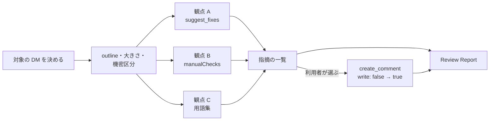

# s1000d-review-skill

[English](./README.md) | **日本語**

[](https://opensource.org/licenses/MIT)

S1000D® のデータモジュール（DM）をレビューし、指摘を comment DM として CSDB に残す Claude Skill です。DM を構造として読み、3 つの観点に分けて指摘を集め、一覧を利用者に見せて、利用者が選んだ指摘だけを comment DM にします。

> [!IMPORTANT]
> このプロジェクトは ASD（Aerospace, Security and Defence Industries Association of Europe）とは無関係の個人プロジェクトです。S1000D® は ASD の登録商標です。

> [!NOTE]
> Skill の指示（`SKILL.md`、`references/`）は日本語で書いています。会話の言語にかかわらず Claude はこれに従います。レビューする DM の言語は問いません。

## 何をするか

このリポジトリは MCP サーバーではなく、S1000D の MCP サーバー群をどの順番で呼び、何を根拠に判断するかを Claude に伝える Markdown の手順書です。

| 観点 | 根拠 | 確からしさ |
|---|---|---|
| 機械で判定できること | s1000d-verify-mcp の `suggest_fixes`（XSD・BREX・参照・適用性） | サーバーの判定。そのまま指摘にします |
| BREX の nonContextRules | s1000d-brex-mcp の `check_against_brex` の `manualChecks` | 本文と照らした LLM の所見。「確認してください」と書きます |
| 文章（用語・書き方） | 利用者が渡した用語集と書き方の決まり | LLM の所見。用語集の該当行を引用します |

すべての指摘に、どの観点の指摘かを書きます。



スタックの 4 つの Skill に共通の原則です。

1. Skill は XML を書きません。comment DM は `create_comment` が組み立てます。
2. 判定はサーバーが下し、Skill は説明します。判定を上書きしません。
3. `fixes[]` の候補の外の値を使いません。この Skill は修正を適用しません。
4. `write: true` の前に利用者に確かめます。
5. 検証状態を必ず報告します。`schema-not-found` と `not-run` は「合格」ではありません。S1000D への準拠は判定しません。
6. 必須の MCP が無いときは止まり、接続の方法を伝えます。任意の MCP が無いときは「未実施（ツール未接続）」と報告します。

本文を引用する前に、DM の `securityClassification` を利用者に見せ、引用してよいかを確かめます。値の意味は解釈しません。

## 前提の MCP

| MCP | 必須 | 役割 | 最低版 |
|---|---|---|---|
| [@shuji-bonji/s1000d-reader-mcp](https://www.npmjs.com/package/@shuji-bonji/s1000d-reader-mcp) | 必須 | DM の一覧と読み取り（`section: "outline"`、`size`、`securityClassification`） | 0.7.0 |
| [@shuji-bonji/s1000d-verify-mcp](https://www.npmjs.com/package/@shuji-bonji/s1000d-verify-mcp) | 必須 | `suggest_fixes` | 0.6.0 |
| [@shuji-bonji/s1000d-brex-mcp](https://www.npmjs.com/package/@shuji-bonji/s1000d-brex-mcp) | 任意 | `check_against_brex`（`manualChecks`）、`explain_brex` | 0.4.0 |
| [@shuji-bonji/s1000d-writer-mcp](https://www.npmjs.com/package/@shuji-bonji/s1000d-writer-mcp) | 任意 | `create_comment`。無ければ指摘を文章で返すだけです | 0.1.1 |

`s1000d-reader-mcp` と `s1000d-verify-mcp` は `plugin.json` の `dependencies` に入っているので、Skill を入れると一緒に入ります。

MCP サーバーには、利用者ご自身が入手した S1000D の配布物（`S1000D_SPEC_DIR`）と CSDB のフォルダー（`S1000D_CSDB_DIR`）が要ります。各サーバーの README を参照してください。

## インストール

```bash
/plugin marketplace add shuji-bonji/claude-plugins
/plugin install s1000d-reader-mcp@shuji-bonji
/plugin install s1000d-verify-mcp@shuji-bonji
/plugin install s1000d-review@shuji-bonji
```

Claude Code に手動で入れるときは、`skills/s1000d-review/` を `~/.claude/skills/s1000d-review` にコピーします。Cowork では、Releases の `.plugin` ファイルをアップロードします。

## 用語集と STE

用語集は、2 列の CSV、Markdown の表、DeepL の用語集のいずれかで渡します。用語集が無いときは、文章の観点を一般的な読みやすさの所見に限り、「用語集の根拠なし」の印を付けます。

> [!WARNING]
> ASD-STE100 の辞書は、このリポジトリにも MCP サーバーにも同梱していません。利用者が辞書のファイルを渡さない限り、この Skill は STE への適合を判定できません。ファイルを渡したときは、その中の語を照合するだけです。

## ディレクトリ構成

```text
s1000d-review-skill/
├── .claude-plugin/plugin.json
├── skills/s1000d-review/
│   ├── SKILL.md
│   └── references/        style.md, comment.md, report.md
├── evals/trigger-eval.json
├── .github/workflows/release.yml
├── README.md / README.ja.md
├── CHANGELOG.md
└── LICENSE
```

## ライセンス

MIT。S1000D の仕様書・XML スキーマ・既定 BREX・公式サンプルは、利用条件により再配布できないため含みません。ASD とは無関係の個人プロジェクトです。S1000D® は ASD の登録商標です。
