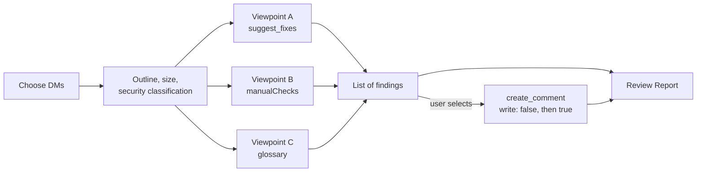

# s1000d-review-skill

**English** | [日本語](./README.ja.md)

[](https://opensource.org/licenses/MIT)

A Claude Skill that reviews S1000D® data modules (DMs) and leaves the findings in the CSDB as comment data modules. It reads a DM as structure, collects findings from three separate viewpoints, shows the list to the user, and creates comment DMs only for the findings the user selects.

> [!IMPORTANT]
> This is a personal project and is not affiliated with ASD (Aerospace, Security and Defence Industries Association of Europe). S1000D® is a registered trademark of ASD.

> [!NOTE]
> The skill instructions (`SKILL.md`, `references/`) are written in Japanese. Claude follows them regardless of the conversation language. The data modules under review can be in any language.

## What it does

This repository is not an MCP server. It is a Markdown playbook that tells Claude in which order to call the S1000D MCP servers, and on what basis to decide.

| Viewpoint | Basis | Certainty |
|---|---|---|
| Machine-checkable | `suggest_fixes` of s1000d-verify-mcp (XSD, BREX, references, applicability) | The server's decision. Used as the finding as is |
| BREX nonContextRules | `manualChecks` of `check_against_brex` in s1000d-brex-mcp | The model's observation against the body text. Written as "please check" |
| Text (terms and style) | The glossary and style rules the user provides | The model's observation. The matching glossary row is quoted |

Every finding says which viewpoint it belongs to.



Principles shared by the four Skills of the stack:

1. The Skill never writes XML. Comment DMs are built by `create_comment`.
2. The servers decide; the Skill explains. It does not overrule a verdict.
3. It does not use a value outside the candidates of `fixes[]`. This Skill applies no fixes.
4. It asks the user before `write: true`.
5. It always reports the verification status. `schema-not-found` and `not-run` are not "valid". S1000D conformance is not decided.
6. If a required MCP is not connected, it stops and says how to connect it. A missing optional MCP is reported as "not performed (tool not connected)".

Before quoting body text, the Skill shows the `securityClassification` of the DM and asks the user whether quoting is allowed. The meaning of the value is not interpreted.

## Prerequisite MCPs

| MCP | Required | Role | Minimum version |
|---|---|---|---|
| [@shuji-bonji/s1000d-reader-mcp](https://www.npmjs.com/package/@shuji-bonji/s1000d-reader-mcp) | Yes | Lists and reads DMs (`section: "outline"`, `size`, `securityClassification`) | 0.7.1 |
| [@shuji-bonji/s1000d-verify-mcp](https://www.npmjs.com/package/@shuji-bonji/s1000d-verify-mcp) | Yes | `suggest_fixes` | 0.6.1 |
| [@shuji-bonji/s1000d-brex-mcp](https://www.npmjs.com/package/@shuji-bonji/s1000d-brex-mcp) | No | `check_against_brex` (`manualChecks`), `explain_brex` | 0.4.0 |
| [@shuji-bonji/s1000d-writer-mcp](https://www.npmjs.com/package/@shuji-bonji/s1000d-writer-mcp) | No | `create_comment`. Without it, the findings are returned as text only | 0.1.1 |

`s1000d-reader-mcp` and `s1000d-verify-mcp` are listed in `dependencies` of `plugin.json`, so installing the Skill installs them too.

The MCP servers need the S1000D distribution you obtained yourself (`S1000D_SPEC_DIR`) and your CSDB folder (`S1000D_CSDB_DIR`). See the README of each server.

## Installation

```bash
/plugin marketplace add shuji-bonji/claude-plugins
/plugin install s1000d-reader-mcp@shuji-bonji
/plugin install s1000d-verify-mcp@shuji-bonji
/plugin install s1000d-review@shuji-bonji
```

For a manual install in Claude Code, copy `skills/s1000d-review/` to `~/.claude/skills/s1000d-review`. For Cowork, upload the `.plugin` file from Releases.

## Terminology list and STE

The Skill reads a terminology list as a two-column CSV, a Markdown table, or a DeepL glossary. Without a list, the text viewpoint is limited to general readability findings, marked as having no glossary basis.

> [!WARNING]
> No ASD-STE100 dictionary is included in this repository or in any MCP server. The Skill cannot decide whether a text complies with STE unless the user provides a dictionary file. With a file, it only checks words against it.

## Directory layout

```text
s1000d-review-skill/
├── .claude-plugin/plugin.json
├── skills/s1000d-review/
│   ├── SKILL.md
│   └── references/        style.md, comment.md, report.md
├── evals/trigger-eval.json
├── .github/workflows/release.yml
├── README.md / README.ja.md
├── CHANGELOG.md
└── LICENSE
```

## License

MIT. This Skill does not include the S1000D specification, XML schemas, default BREX or official samples, because their terms of use do not grant redistribution. This is a personal project and is not affiliated with ASD. S1000D® is a registered trademark of ASD.
