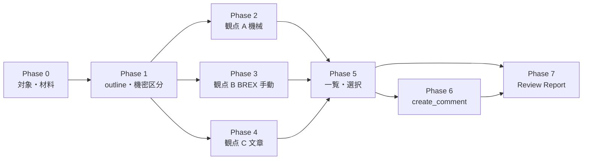

# s1000d-review — DM のレビューと comment DM

既存の DM を読み、指摘を 3 つの観点に分けて集め、利用者が選んだ指摘を comment DM として CSDB に残す Skill。
CSDB の中でレビューは comment DM で回る。この Skill は DM を書き換えない。

自前の判定ロジックは持たない。機械で判定できることは verify と brex の応答を根拠にし、
文章の所見は利用者が渡した用語集と書き方の決まりだけを根拠にする。

## 原則（4 つの Skill 共通）

1. **XML を書かない。** XML は writer が組み立てる。この Skill の手順に、LLM が XML を書く工程は無い。comment DM も `create_comment` に文を渡して作る。
2. **判定はサーバーが下し、Skill は説明する。** XSD・BREX・参照・適用性の判定と修正の候補は MCP の応答をそのまま根拠にする。応答を読んで利用者に説明し、次の操作を決めるだけで、判定を上書きしない。
3. **候補の外の値を使わない。** 修正の案は `fixes[]` の候補から選ぶ。`confidence: none` のときと、`valueForm` が `range` / `pattern` のときは利用者に聞く。この Skill は修正を適用しないので、案を示すところまでになる。
4. **書き込む前に確かめる。** `write: true` は、利用者が書き込み先と内容を確認してからにする。
5. **検証状態を必ず報告に書く。** `schema-not-found` と `not-run` を「合格」と書かない。S1000D への準拠は判定しない。
6. **前提の MCP が無いときは止まる。** 必須の MCP が接続されていなければ、その旨と接続の方法を伝えて止まる。任意の MCP が無いときは、報告の該当項目に「未実施（ツール未接続）」と書く。

## 前提 MCP

| MCP | 必須/任意 | 役割 | 最低版 |
|---|---|---|---|
| s1000d-reader-mcp | **必須** | `list_data_modules` で対象を一覧にする。`read_data_module` で DM を構造として読む（`section: "outline"`、`size`、`securityClassification`） | 0.7.1 |
| s1000d-verify-mcp | **必須** | `suggest_fixes` で XSD・BREX・参照・適用性の指摘と修正の候補を得る | 0.6.1 |
| s1000d-brex-mcp | 任意 | `check_against_brex` の `manualChecks`（nonContextRules の本文）、`explain_brex` でルールの説明 | 0.4.0 |
| s1000d-writer-mcp | 任意 | `create_comment` で comment DM を作る。無ければ指摘を文章で返すだけ | 0.1.1 |

必須の MCP が無いときは、監査せずに止まり、次を伝える。

- `/plugin install s1000d-reader-mcp@shuji-bonji`
- `/plugin install s1000d-verify-mcp@shuji-bonji`
- 設定ファイル `~/.config/s1000d-stack/config.json` の `specDir`（利用者が入手した S1000D の配布物）と `csdbDirs`（プロジェクトの CSDB）。環境変数が MCP に渡らない環境では、こちらに書く

## 手順

### Phase 0 — 対象と材料を確かめる

利用者に次を確かめる。分かっていることは聞き直さない。

- 対象: DM の DMC かファイルのパス、またはフォルダー。複数なら Phase 1 の一覧で範囲を決める
- **CSDB のフォルダー（`csdbDirs`）**: 参照の解決、BREX の連鎖、comment DM の連番に要る。無いと `suggest_fixes` の参照はすべて `no-csdb` の理由で未解決になる。これは DM の指摘ではないので、指摘に数えない。フォルダーが分からなければ Phase 2 の参照は「未実施」と書く
- 製品（`product`）: 適用性まで見るときだけ。属性の id と値は reader の `describe_applicability` で調べる
- 用語集と書き方の決まりのファイル（`references/style.md` の形式）。無ければ「用語集なし」で進める
- comment DM にするときの決まり（`commentType`、`commentPriorityCode`、発信者、機密区分）。`references/comment.md`

### Phase 1 — 対象を読む前に大きさと機密区分を見る

1. 複数の DM なら `list_data_modules`（`filter` で `infoCode`・`schemaName`・`text` を絞る）で一覧にし、範囲を利用者と決める。件数が多いときは `offset` / `limit` で分ける
2. DM 1 件ごとに `read_data_module` を `section: "outline"` で呼ぶ。見るのは次の 3 つ。
   - `securityClassification`: `dataModule`（識別・状態部の値）と `inContent`（本文の要素に付いた値ごとの数）。応答の先頭にある
   - `content.size`: 節点数・文字数・警告の数。読む量の見当になる
   - `verification`: Phase 6 の報告に使う
3. **機密区分の確認**: `securityClassification` の値の意味はサーバーが解釈しない（プロジェクトが決める）。本文を引用する前に、値を利用者に見せて、報告と comment DM に本文を引用してよいかを確かめる。`inContent` が空でないときは、値の違う要素があることも伝える。利用者が「この値は引用してよい」と答えたら、同じ値の DM はこの会話では聞き直さない。答えが「引用しない」なら、指摘は場所（DMC・手順の番号・節の題名）と観点だけで書き、本文の文は書かない
4. 大きい DM は `outline` で当たりを付け、`section: "content"` で必要な範囲を読む。`maxNodes` の上限で本文が切れたら、切れたことを報告に書く

### Phase 2 — 観点 A: 機械で判定できること

`s1000d-verify-mcp: suggest_fixes` を DM 1 件ごとに呼ぶ（`path` か `xml`、`csdbDirs`。適用性を見るなら `product`）。

応答の読み方:

| 項目 | 意味 |
|---|---|
| `verification` | `schema.state`（valid / invalid / schema-not-found / not-run）、`brex.state`（passed / violations / incomplete / not-run）、`references.state`（resolved / unresolved / not-run） |
| `fixes[]` | 指摘 1 件。`kind`（schema / brex-value / brex-forbidden / brex-missing / brex-notation / reference / applicability）、`location`（XPath と行）、`problem`、`candidates[]`、`confidence`、`source`、`note`、`brSeverityLevel` |
| `byConfidence` / `fixCount` | 件数。`maxFixes` で切れたときは `_notes` に書いてある。切れていたら `maxFixes` を上げて呼び直す |
| `applicability` | `product` を渡したときだけ。`checked: false` は適用性を見ていない |

扱い:

- `fixes[]` の 1 件を指摘 1 件にする。`problem` と `location`、`source` はそのまま写す。判定を言い換えて強めたり弱めたりしない
- `brSeverityLevel`（`brsl01`〜`brsl99`）は解釈せず、値をそのまま添える
- **`schema.state` が `invalid` のとき**は、BREX の指摘が誤って出たり隠れたりする。BREX の指摘に「XSD 違反があるため参考」と添える
- `schema-not-found` は「XSD を見つけられなかった」で、合格ではない。`list_schemas` で原因を調べ、`specDir` の設定を伝える
- `references.state` が `unresolved` でも、理由が `no-csdb` なら Phase 0 の `csdbDirs` の問題。指摘にしない
- 仕様書そのものへの `dmRef`（モデル識別コード `S1000D`）は、既定で一覧に出ない。エラーではない
- 修正の案は、`confidence: exact` なら候補 1 件を「案」として示す。`several` は候補を並べる。`none` と `valueForm` が `range` / `pattern` の候補は、利用者に値を聞く案内にする。この Skill は修正を適用しない（適用は s1000d-publish の `apply_fixes`）

### Phase 3 — 観点 B: BREX の nonContextRules

機械で判定できない取り決めは、LLM が本文と照らした所見になる。確からしさは機械の判定より低い。

1. brex-mcp があれば `check_against_brex`（`path`、`csdbDirs`）を呼ぶ。`layers[].manualChecks[]`（`ruleId` と `text`）が、人が確認する取り決めの本文になる。ルールの説明が要るときは `explain_brex`（`kind: "nonContext"`、`context` に DM のスキーマ名、例 `proced`）
2. `layers[].violations` が空でなければ、観点 A と同じ扱いの機械の指摘として加える（`explain_brex` で説明できる）
3. 各 `manualChecks` の取り決めを、Phase 1 で読んだ本文と照らす。照らした結果は次の 3 つのどれかにする。
   - 抵触の疑い: 本文のどこが、どの取り決めに当たりそうか。「確認してください」と書く
   - 本文からは判断できない: 承認の手続きなど、DM の外にある取り決め。「人が確認する」と書く
   - 該当する本文が無い
4. brex-mcp が無いときは、`suggest_fixes` の `verification.brex.manualChecks`（件数）だけを報告し、「BREX の手動確認 N 件: 未実施（ツール未接続）」と書く。取り決めの本文を推測で書かない

仕様書や BREX の文を、報告にまとめて写さない。必要な取り決めは `ruleId` と、プロジェクトの BREX が返した `text` の該当箇所の引用にとどめる。

### Phase 4 — 観点 C: 文章（用語・書き方）

根拠は利用者が渡した用語集と書き方の決まりだけ。形式と、ファイルが無いときの扱いは `references/style.md`。

- 用語集がある: 本文の語を用語集と照合する。指摘には用語集の該当行（原語・採用語・禁止語）を引用する。行に無い語を、LLM の好みで指摘しない
- 用語集が無い: 「用語集なし」と報告に書き、一般的な読みやすさ（1 文が長い、主語が無い、指示の対象が曖昧）の所見だけを返す。この所見は「用語集の根拠なし」の印を付ける
- **STE（ASD-STE100）の辞書は同梱しない。** 「STE に沿っているか」と頼まれても、辞書が渡されていなければ STE への適合は判定できない。そう伝え、利用者が辞書のファイルを渡したときだけ照合する

### Phase 5 — 指摘の一覧を見せ、comment DM にするものを選んでもらう

指摘に通し番号（R-1, R-2…）を付け、次の列で一覧にして見せる。

| 番号 | 観点 | 場所 | 指摘 | 根拠 | 確からしさ |
|---|---|---|---|---|---|

- 観点は `機械` / `BREX手動` / `文章` のどれか。必ず書く。観点の混ぜ書きをしない
- 確からしさは `サーバーの判定`（観点 A）、`LLM の所見（確認してください）`（観点 B）、`LLM の所見（用語集の行を引用）` または `LLM の所見（用語集の根拠なし）`（観点 C）
- 機密区分の確認で「引用しない」と決まった DM は、本文の文を一覧に書かない

利用者に、comment DM にする番号を選んでもらう。選ばれなかった指摘は報告に残す。writer が無いときは、ここで一覧を最終の返答にする。

### Phase 6 — comment DM を作る（writer があるとき）

入力の作り方は `references/comment.md`。要点だけ書く。

1. `commentType`・`commentPriorityCode` は、プロジェクトの決まりで選ぶ。決まりが無ければ利用者に聞く。サーバーも Skill も意味を付けない
2. `originator.address` の `city` と `country`、`senderIdent`（5 文字）、`modelIdentCode`、`securityClassification`、`language` は省略できない。分からなければ聞く
3. 対象の DM 1 件につき comment DM 1 件。選ばれた指摘を `paragraphs` に 1 件ずつ入れる
4. まず `write: false` で呼び、`xml` の要点（`commentCode`、`fileName`、`paragraphs`）と `verification` を利用者に見せる
5. 利用者が確認したら `write: true`。書き込み先は `csdbDirs` の先頭のフォルダー。`writeSkipped`（`no-csdb-dir`、`write-conflict`、`schema-invalid`）が返ったら、理由を伝えて止まる。`overwrite` と `allowInvalid` は、利用者が明示したときだけ使う
6. 書いた comment DM を reader・verify で確かめるときは、reader 0.7.1・verify 0.6.1 以降なら、起動した後に書いたファイルも次の呼び出しから見える。それより古い版は、書いた直後の comment DM が見つからないことがある。その場合は reader・verify を起動し直す

### Phase 7 — Review Report

`references/report.md` の雛形で返す。必ず入れる項目: 対象、観点ごとの指摘、comment DM にしたもの／しなかったもの、用語集の有無、検証状態、未実施の項目。

## 全体の流れ



## 場面ごとの判断

| 場面 | 判断 |
|---|---|
| `suggest_fixes` の `fixes[]` がすべて `no-csdb`（`No CSDB folders were given to search`）で `confidence: none` | DM の指摘ではない。`csdbDirs` が渡っていない。Phase 0 に戻って聞く。聞けなければ参照は「未実施」と書き、指摘の件数に数えない |
| `schema.state` が `valid`、`brex.state` が `passed`、指摘が 0 件 | 「機械で判定できる範囲に指摘なし」と書く。「問題なし」「準拠」とは書かない。観点 B と C は別に行う |
| `brex.manualChecks` の件数が 0 でない | 観点 B を行う。件数だけ書いて終わらない（brex-mcp が無いときを除く） |
| 手動確認の取り決めが、承認の手続きや CSDB 全体の運用についてのもの（本文に現れない） | 「本文からは判断できない（人が確認）」と書く。DM の欠陥として指摘しない |
| 利用者が「STE に沿っているか」と頼み、辞書が無い | 辞書が無いので適合は判定できないと答える。用語集があれば用語の照合に切り替えるかを聞く |
| 利用者が「直して」と頼む | レビューは書き換えない。修正の適用は `s1000d-publish` の手順（`apply_fixes`）になると伝え、候補付きの `fixes[]` を渡す |
| 指摘が多く、comment DM が長くなる | DM 1 件につき comment DM 1 件を保つ。長くなる場合は、利用者に選ぶ番号を絞ってもらう。1 つの指摘を複数の comment DM に分けない |
| `read_data_module` の本文が `maxNodes` で切れた | 切れたことを報告に書く。読めていない範囲の観点 B・C の指摘は出さない |

## 応答の例（読み方の確認用）

手順 DM を `csdbDirs` なしで `suggest_fixes` に通すと、次のような応答になる（項目を抜粋）。

```json
{
  "verification": {
    "schema": { "state": "valid" },
    "brex": { "state": "passed", "manualChecks": 3 },
    "references": { "state": "unresolved", "checked": 10, "unresolvedCount": 10 }
  },
  "fixCount": 10,
  "byConfidence": { "exact": 0, "several": 0, "none": 10 },
  "fixes": [{ "kind": "reference", "problem": "No CSDB folders were given to search",
              "candidates": [], "confidence": "none", "source": "CsdbIndex" }]
}
```

読み方: XSD は valid、BREX の機械のルールは passed。10 件の参照は、CSDB のフォルダーが無いので確かめられていない。これは DM の欠陥ではない。BREX の手動確認が 3 件ある。次にやることは、`csdbDirs` を聞いて呼び直すことと、`check_against_brex` で 3 件の本文（`layers[].manualChecks[]` の `ruleId` と `text`）を取ること。

## 検証状態の書き方

- `schema: valid` と `brex: passed` は「XSD と、機械で検査できる BREX のルールに誤りが無かった」だけを意味する。S1000D への準拠とは書かない
- `schema-not-found` と `not-run` は「未検証」と書く
- `brex: incomplete` は、BREX の連鎖に未解決のものがあるか、評価できないルールがある。確認済みと書かない

## やらないこと

- DM の書き換え、修正の適用
- S1000D への準拠の判定、BREX の重大度の解釈
- STE への適合の判定（辞書が渡されたときの語の照合を除く）
- 図の中身の読み取り（図は ICN の参照と題だけを読む）
- 仕様書・STE の辞書の文の引用
- 機密区分の確認前の本文の引用
